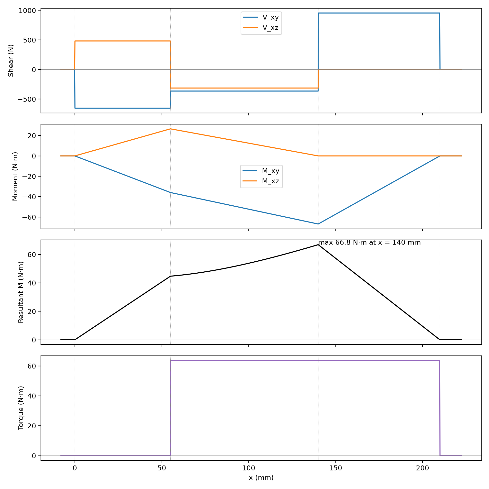
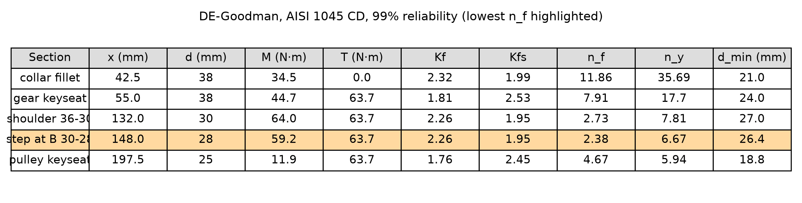
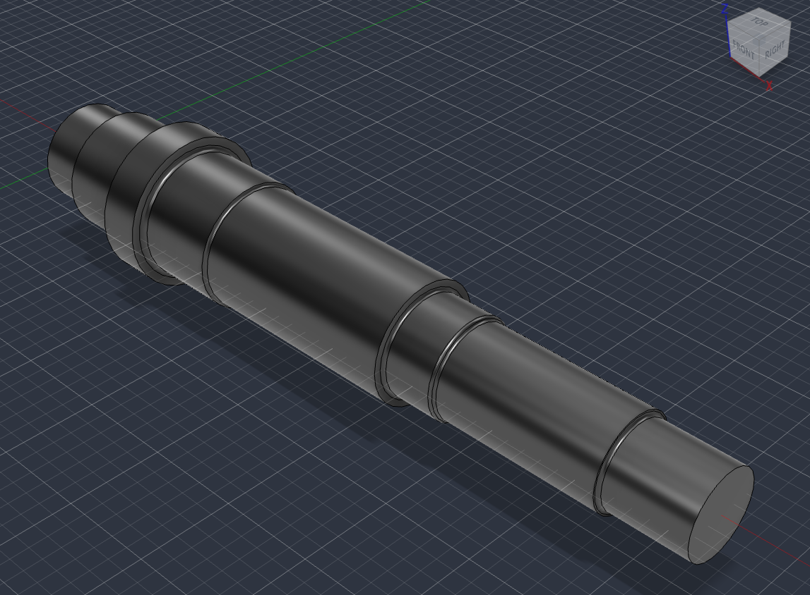

# Day 01: Gearbox Output Shaft

Size the output shaft of a 3 kW, 3.2 : 1 single-stage spur reducer for infinite life. The shaft carries the 64-tooth gear between two bearings and an overhung V-belt pulley.

**Result:** every section passes $n_f \ge 2$ and $n_y \ge 2$. The governing section is **not** at the gear: it's the Ø30 → Ø28 step next to bearing B ($n_f$ = 2.38), because the overhung pulley puts the peak bending moment (66.8 N·m) over bearing B.

## Problem

| Quantity | Value |
|---|---|
| Power, speed | 3 kW, 1440 → 450 rpm (20 : 64 teeth) |
| Output torque | 63.7 N·m |
| Gear | pitch Ø160 mm, 20° pressure angle, at x = 55 mm |
| Pulley | pitch Ø200 mm, at x = 210 mm (70 mm overhang), F1/F2 = 5 |
| Bearings | A at x = 0, B at x = 140 mm |
| Material | AISI 1045 cold drawn, Sut = 630 MPa, Sy = 530 MPa, machined, 99 % reliability |

## 1. Loads and moment diagrams (`loads.py`)

| Force | Value | Direction |
|---|---|---|
| Gear tangential Wt | 795.8 N | −z |
| Gear radial Wr | 289.6 N | +y |
| Belt pull F1 + F2 | 954.9 N | −y |

Reactions: xz plane R_A = 483.1 N, R_B = 312.6 N; xy plane R_A = −653.3 N, R_B = 1318.6 N.

The two planes are solved separately and combined as $M = \sqrt{M_{xy}^2 + M_{xz}^2}$. The script checks force balance, zero moment at the free end, and that M at B equals belt pull × overhang.



## 2. Fatigue at every critical section (`fatigue.py`)

DE-Goodman with Marin factors ($k_a$ = 0.817, $k_b$ per diameter, $k_e$ = 0.814), Shigley first-iteration $K_t$ and Neuber notch sensitivity. Bending is fully reversed, torque is steady.



| Section | x (mm) | d (mm) | M (N·m) | n_f | n_y |
|---|---|---|---|---|---|
| Collar fillet | 42.5 | 38 | 34.5 | 11.86 | 35.69 |
| Gear keyseat | 55.0 | 38 | 44.7 | 7.91 | 17.70 |
| Shoulder Ø36 → Ø30 | 132.0 | 30 | 64.0 | 2.73 | 7.81 |
| **Step at B Ø30 → Ø28** | **148.0** | **28** | **59.2** | **2.38** | **6.67** |
| Pulley keyseat | 197.5 | 25 | 11.9 | 4.67 | 5.94 |

Full table, including $K_f$, $K_{fs}$, $S_e$ and the DE-Goodman minimum diameter for n = 2: `results.csv`.

## 3. CAD (Fusion)

Parametric shaft: every diameter, length and fillet is a named user parameter, so later days (5, 7, 24) can change it.



## Takeaway

I expected the gear keyseat to govern. It has the largest stress concentration in torsion, but it sits where the moment is only 44.7 N·m. The overhung pulley levers the shaft over bearing B, so the small steps beside B carry 59–64 N·m and set the design. Ø30 at the bearings is enough ($n_f$ = 2.38 at the worst step). Day 7 refines the $K_t$ at the x = 132 mm shoulder with FEA.

**Limitations:** first-iteration $K_t$ values (conservative); simple supports at bearing centres; point loads.

## Run

```bash
python loads.py
python fatigue.py
```

## AI use

`loads.py` and the hand calculation are my own. `fatigue.py` and this README were written with Claude (AI) from my method and numbers, and I checked them against my hand calculation.

## References

- Budynas & Nisbett, *Shigley's Mechanical Engineering Design* (shaft design, fatigue, notch sensitivity).
- Pilkey & Pilkey, *Peterson's Stress Concentration Factors*.
