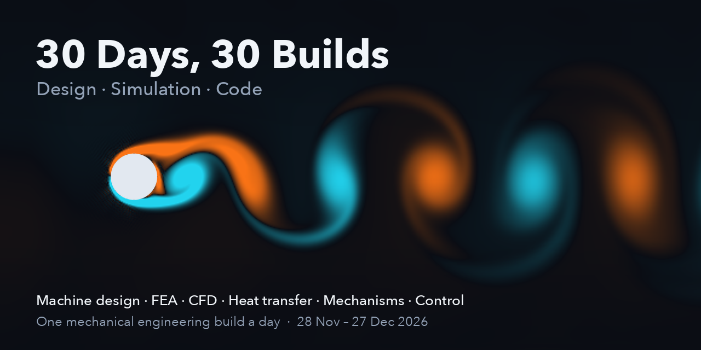

# 30 Days, 30 Builds: Design, Simulation & Code


One mechanical engineering build a day for 30 days, from **28 Nov to 27 Dec 2026**, covering machine design, structural FEA, CFD, heat transfer, mechanisms and vibration, and control systems.

Every build follows the same rule: **no result without a check.**

1. **Hand calc:** the answer I expect, worked out first.
2. **Model or code:** Fusion, OpenFOAM or my own Python solver.
3. **Compare:** the gap between the two, and where it comes from.
4. **Decide:** one design decision or one lesson on accuracy, stability or behaviour.

When the hand calc and the simulation disagree, the write-up says so and works out why.

Daily posts on X: **[@harrykesh067](https://x.com/harrykesh067)**

---

## The builds

💻 coding day · ⭐ block closer

### Block 1: Machine Design & CAD

| Day | Date | Build | Tools | Status |
|---|---|---|---|---|
| 01 | 28 Nov | Gearbox output shaft: loads → fatigue sizing → parametric CAD | Python, Fusion | DONE✅️ |
| 02 | 29 Nov | Spur gear pair: Lewis bending and AGMA contact stress | Python, Fusion | coming |
| 03 | 30 Nov | Bearing selection (L10 life) + housing | Python, Fusion | coming |
| 04 | 01 Dec | Eccentrically loaded bolted bracket + GD&T drawing | Python, Fusion | coming |
| 05 ⭐ | 02 Dec | Single-stage gear reducer assembly | Fusion | coming |

### Block 2: Structural FEA

| Day | Date | Build | Tools | Status |
|---|---|---|---|---|
| 06 | 03 Dec | Plate with a hole: stress concentration + mesh convergence | Fusion Simulation | coming |
| 07 | 04 Dec | Shaft shoulder fillet study (Day 1 shaft) | Fusion Simulation | coming |
| 08 | 05 Dec | Lightweighting a bracket over three FEA iterations | Fusion Simulation | coming |
| 09 💻 | 06 Dec | My own 2D frame FEM solver | Python, PyNiteFEA | coming |
| 10 ⭐ | 07 Dec | Column buckling: Euler, Johnson and imperfections | Python, Fusion Simulation | coming |

### Block 3: CFD & Fluid Numerics

| Day | Date | Build | Tools | Status |
|---|---|---|---|---|
| 11 💻 | 08 Dec | Convection–diffusion: central vs upwind vs QUICK | Python | coming |
| 12 | 09 Dec | Backward-facing step vs Armaly et al. (1983) | OpenFOAM, ParaView | coming |
| 13 | 10 Dec | Flow past a cylinder: steady wake and vortex shedding | OpenFOAM, ParaView, Python | coming |
| 14 💻 | 11 Dec | Pipe network solver: Hardy Cross vs Newton–Raphson | Python | coming |
| 15 ⭐ | 12 Dec | Orifice plate flow meter vs ISO 5167 | OpenFOAM, ParaView | coming |

### Block 4: Heat Transfer

| Day | Date | Build | Tools | Status |
|---|---|---|---|---|
| 16 💻 | 13 Dec | 2D transient conduction solver: explicit vs Crank–Nicolson | Python, Fusion Thermal | coming |
| 17 | 14 Dec | Heat sink fin design | Python, Fusion Thermal | coming |
| 18 | 15 Dec | Natural convection on a heated vertical plate | OpenFOAM, ParaView | coming |
| 19 💻 | 16 Dec | Double-pipe heat exchanger: LMTD, NTU and a 1D marching model | Python | coming |
| 20 ⭐ | 17 Dec | Shrink fit: Lamé vs thermal + structural FEA | Python, Fusion Simulation | coming |

### Block 5: Mechanisms & Vibration

| Day | Date | Build | Tools | Status |
|---|---|---|---|---|
| 21 💻 | 18 Dec | Windshield wiper four-bar: synthesis and Newton–Raphson position solver | Python, Fusion | coming |
| 22 | 19 Dec | Slider-crank + flywheel sizing | Python, Fusion | coming |
| 23 | 20 Dec | Cam profile design with cycloidal motion | Python, Fusion | coming |
| 24 💻 | 21 Dec | Torsional vibration of the Day 5 gearbox | Python | coming |
| 25 ⭐ | 22 Dec | Keeping a motor bracket out of resonance | Python, Fusion Simulation | coming |

### Block 6: Control Systems

| Day | Date | Build | Tools | Status |
|---|---|---|---|---|
| 26 💻 | 23 Dec | DC motor speed control: PID, saturation and anti-windup | Python (python-control) | coming |
| 27 💻 | 24 Dec | Lead–lag servo design and discretisation | Python (python-control) | coming |
| 28 💻 | 25 Dec | Active suspension with LQR on a quarter-car | Python (python-control, SciPy) | coming |
| 29 💻 | 26 Dec | Temperature control of a heated block | Python | coming |
| 30 ⭐ | 27 Dec | Capstone: motorised gearbox positioning system | Python | coming |

The builds connect: the Day 1 shaft returns on Day 7, the Day 5 gearbox on Days 24 and 30, and the Day 16 solver on Day 29.

---

## Warm-up projects

Built before the series started.

| Folder | What it is |
|---|---|
| [`-1_LatticeBoltzman_Solver`](-1_LatticeBoltzman_Solver/) | Interactive 2D wind tunnel in the browser: D2Q9 Lattice Boltzmann solver in NumPy, FastAPI WebSocket server, WebGL renderer. (A C++ rewrite is in progress). |
| [`00_Kalman_Filters`](00_Kalman_Filters/) | Linear and extended Kalman filters (work in progress). |

---

## Repository layout

Each day gets its own folder, named `NN_Short_Name/`:

```
NN_Short_Name/
├── README.md        problem → hand calc → simulation or code → comparison → takeaway
├── *.py / *.ipynb   hand calcs, solvers, plotting
├── figures/         plots, contours and animations
└── cad/ or case/    Fusion exports and screenshots, or an OpenFOAM case (setup files only)
```

For OpenFOAM days, only the case setup (`0/`, `constant/`, `system/`) is committed. Run the case to regenerate the results.

## Running the code

Python 3.13, from the repository root:

```bash
python3 -m venv .venv
source .venv/bin/activate
pip install -r REQUIREMENTS.txt
```

Each day's README lists anything else it needs.

**Other tools:** Autodesk Fusion (CAD and Simulation), OpenFOAM in Docker, ParaView.

## Alongside this: Mathematics Behind Engineering

A slower, weekly series on X working through the mathematics under these tools: proofs, linear algebra, ODEs, PDEs and numerical analysis. Where a build uses an idea (the singular stiffness matrix on Day 9, eigenvalues on Day 24, least squares on Day 29), the maths posts pick it up.

## Feedback

If you spot an error in a hand calc, a model set-up or the code, please open an issue or reply on X. Corrections get credited in the day's README.

**Anything that has used AI, directly or indirectly will be promptly reported in the code itself or README for that project, the goal is to learn and show up** !!

---

*Harikesh Pratap Verma · B.Tech Mechanical Engineering, IIT (ISM) Dhanbad*
